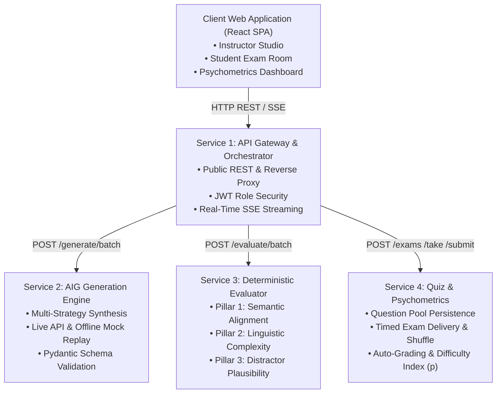
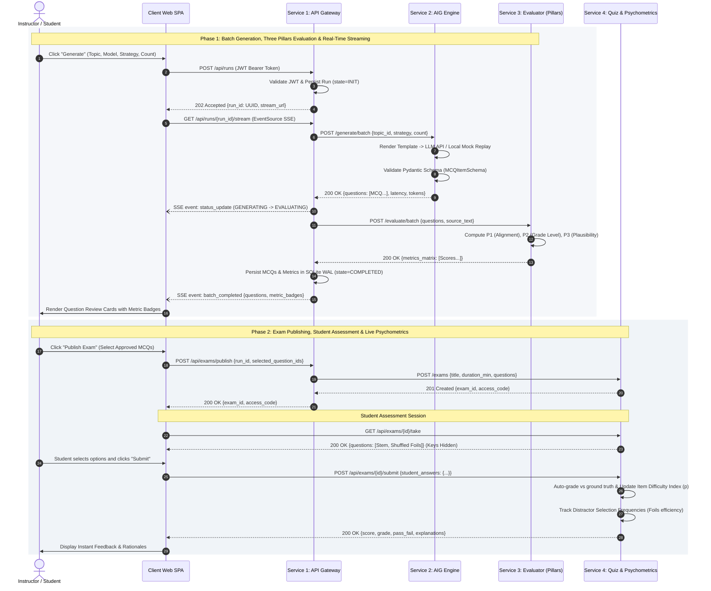

# PROGRAMMING 5 (PROGRAMOZÁS 5) — PROJECT PROPOSAL

## EduGen: Distributed Microservices Platform for Automated Question Generation, Deterministic Evaluation, and Assessment Delivery

| Field | Detail |
| :--- | :--- |
| **Course & Faculty** | Programming 5 (*Programozás 5*), PTE MIK — Faculty of Engineering & IT |
| **Instructor / Professor** | Prof. Gergely Laborci |
| **Student & Neptun ID** | Rakhi Mst Rokaya Akter (Neptun: `ZA0P52`) |
| **Architectural Target** | 4 Decoupled Microservices + Modern Web Client (Docker Compose Orchestration) |
| **Document Target** | Combined Functional & Technical Specification Proposal |

---

## 1. Executive Summary & Motivation

Modern engineering curricula require continuous, diagnostic testing to reinforce complex technical mechanisms (e.g. computer networking protocols, systems theory, specialized algorithms). However, manual construction of Multiple-Choice Questions (MCQs) is notoriously labor-intensive: educators must craft clear question stems while engineering three plausible, non-trivial distractors (incorrect options) that reflect genuine misconceptions. While foundation Large Language Models (LLMs) can generate assessment items at high speed, unconstrained generation frequently suffers from factual hallucinations, formatting drift, and trivial distractors.

This project proposes **EduGen**, a cloud-native, distributed microservices platform designed to operationalize Automated Item Generation (AIG) and empirical pedagogical measurement. The project directly satisfies all core requirements of **Programming 5** by implementing **4 decoupled microservices and a modern client web application**, orchestrated via Docker Compose. Furthermore, this project operationalizes the candidate's BSc thesis research (*"LLM Comparative Framework for Automated Technical Question Generation"*), transforming an offline Python batch script pipeline into an observable, scalable, and production-grade distributed system.

---

## 2. High-Level Architectural Blueprint

The platform adheres to Domain-Driven Design (DDD) principles with clear bounded contexts. Rather than an arbitrary technical split, each service encapsulates an independent responsibility:



| Component | Bounded Domain / Responsibility | Technology Stack |
| :--- | :--- | :--- |
| **Service 1: API Gateway & Orchestrator** | Public API routing, JWT authentication, batch job lifecycle coordination, and real-time generation streaming. | Python / FastAPI, SQLite (WAL), SSE |
| **Service 2: AIG Generation & Multi-Agent Engine** | Prompt injection, model abstraction (OpenAI / NVIDIA NIM / Local Mock Mode), and structured JSON validation. | Python / FastAPI, Pydantic, HTTP Client |
| **Service 3: Deterministic Evaluation Service** | Independent NLP service computing "The Three Pillars" of pedagogical quality (Semantic Alignment, Readability, Distractor Plausibility). | Python / FastAPI, `textstat`, scikit-learn, NumPy |
| **Service 4: Assessment & Psychometrics Delivery** | Test bank storage, timed student quiz delivery, automated scoring, and live item difficulty ($p$-value) psychometrics. | Python / FastAPI, SQLite, SQLAlchemy |
| **Client Application (Web Portal)** | Responsive Single-Page Application (SPA) offering an Instructor Studio, live metric inspection badges, and a Student Exam Room. | React 18, Vite, Tailwind CSS |

---

## 3. Combined Functional & Technical Specification Requirements

### 3.1 Service 1: API Gateway & Orchestrator Service
* **FR-1.1 (Centralized Routing & Reverse Proxy):** The gateway shall ingest all client requests and dispatch them to internal downstream microservices while masking private container network topology.
  * **TR-1.1:** Implemented as an asynchronous FastAPI application running on Uvicorn. Exposes CORS-configured public REST routes and proxies requests to internal containers across an isolated Docker bridge network.
* **FR-1.2 (Role-Based Authentication & Session Handling):** The gateway shall enforce distinct user roles: *Instructor* (generation privileges, metric analysis) and *Student* (quiz taking privileges only).
  * **TR-1.2:** Issues cryptographically signed JSON Web Tokens (JWT) using HMAC-SHA256. Protected endpoints validate claims via FastAPI dependency injection middleware.
* **FR-1.3 (Pipeline Orchestration & Job Tracking):** Allows instructors to trigger a complete generation-and-evaluation batch run for a specified syllabus topic, tracking states (`INIT` $\to$ `GENERATING` $\to$ `EVALUATING` $\to$ `COMPLETED` $\to$ `FAILED`).
  * **TR-1.3:** Maintains run metadata in an internal SQLite database using Write-Ahead Logging (WAL) to prevent lock contention during concurrent status queries.
* **FR-1.4 (Real-Time Generation Progress Streaming):** Streams real-time progress events to the client UI as questions are synthesized and evaluated, eliminating inefficient polling.
  * **TR-1.4:** Implements Server-Sent Events (SSE) via `EventSourceResponse`, streaming structured event packets (`status_update`, `question_generated`, `question_evaluated`).

---

### 3.2 Service 2: AIG Generation & Multi-Agent Engine
* **FR-2.1 (Multi-Strategy Question Synthesis):** Supports multiple question generation strategies: Baseline Zero-Shot (single prompt injection), RAG-grounded generation (retrieving syllabus text chunks), and Multi-Agent refinement (Examiner drafts $\to$ Critic audits distractors $\to$ Editor finalizes).
  * **TR-2.1:** Standardized Jinja/string prompt template managers inject curriculum parameters. Output payloads are strictly parsed and validated against Pydantic schemas (`MCQItemSchema`: stem, options A–D, correct_option, explanation).
* **FR-2.2 (LLM Provider Abstraction & Dual-Mode Execution):** Supports live foundation models (OpenAI, NVIDIA NIM Llama 3.3 / Mistral) alongside a 100% deterministic Local Mock / Replay Mode.
  * **TR-2.2:** An abstract `LLMProvider` factory dynamically routes calls. The Local Mock Provider serves pre-cached, verified questions from the thesis dataset ($N=2,080$), guaranteeing 100% offline stability, zero API fees, and instant response times during professor demonstrations.
* **FR-2.3 (Batch Synthesis Endpoint):** Accepts requests specifying topic domain, item count ($1 \le N \le 10$), and model alias, returning structured questions with latency and token usage metrics.
  * **TR-2.3:** Exposes `POST /generate/batch` accepting `{topic_id, domain, source_text, strategy, model_name, count}` and returning `{questions: [...], latency_seconds, token_usage}`.

---

### 3.3 Service 3: Deterministic Evaluation Service ("The Three Pillars")
* **FR-3.1 (Pillar 1 — Semantic Alignment & Hallucination Guard):** Measures the factual proximity of the generated question stem to the official syllabus reference text to detect fabrications.
  * **TR-3.1:** Computes Term Frequency-Inverse Document Frequency (TF-IDF) n-gram vectorization and Cosine Similarity, producing a normalized score in $[0.0, 1.0]$.
* **FR-3.2 (Pillar 2 — Linguistic Complexity & Readability):** Assesses the academic grade level of the question stem to verify appropriate targeting for undergraduate engineering students.
  * **TR-3.2:** Implements Flesch-Kincaid Grade Level and Flesch Reading Ease via the `textstat` library using syllable and sentence boundary tokenization.
* **FR-3.3 (Pillar 3 — Distractor Plausibility & Foil Diversity):** Measures how plausible and challenging the incorrect options (foils) are relative to the key, ensuring distractors are not giveaway trivialities.
  * **TR-3.3:** Computes pairwise Jaccard Token Similarity between each foil and the correct answer, alongside pairwise inter-distractor divergence to verify distinct misconceptions.
* **FR-3.4 (Automated Quality Gate & Anomaly Flagging):** Flags defective questions failing basic pedagogical constraints (e.g., duplicate options, length asymmetry $>3\times$, or alignment $<0.15$).
  * **TR-3.4:** Exposes stateless endpoints `POST /evaluate/item` and `POST /evaluate/batch`. Being stateless and memory-efficient, this service scales horizontally without database locks.

---

### 3.4 Service 4: Assessment & Psychometrics Delivery Service
* **FR-4.1 (Test Bank Repository & Exam Publishing):** Stores approved questions into organized question pools and enables instructors to publish timed exams with passing thresholds.
  * **TR-4.1:** Relational SQLite/PostgreSQL schema tracking `exams`, `exam_questions` (foreign keys to approved items), and `student_submissions`.
* **FR-4.2 (Interactive Student Exam Delivery):** Serves active exams to students with randomized option shuffling (to eliminate positional guessing bias) while concealing ground-truth keys.
  * **TR-4.2:** Exposes `GET /exams/{id}/take`, returning questions with randomized option orders and strictly sanitizing out `correct_option` and `explanation` prior to submission.
* **FR-4.3 (Instant Automated Grading & Feedback):** Evaluates student submissions instantaneously upon receipt, providing a final percentage score, pass/fail status, and per-item answer rationales.
  * **TR-4.3:** Exposes `POST /exams/{id}/submit` receiving student choices `{question_id: selected_option}`, comparing against ground truth, and writing results to `student_responses`.
* **FR-4.4 (Empirical Psychometric Analytics):** Computes authentic psychometric metrics on delivered questions: Item Difficulty Index ($p$-value = correct attempts / total attempts) and Distractor Efficiency (selection frequency of each foil).
  * **TR-4.4:** Exposes `GET /exams/{id}/analytics` aggregating item statistics. Flags defective questions where students never chose a distractor (dead foil) or where $p < 0.20$ (excessively confusing item).

---

### 3.5 Client Web Application (Frontend)
* **FR-5.1 (Instructor Studio & Generation Controls):** Enables instructors to select syllabus topics (e.g., Computer Networks, Algorithms, Systems Theory), choose model strategies, and trigger batch generation.
  * **TR-5.1:** Developed with React 18, Vite, and Tailwind CSS. Implements an `EventSource` listener to render a live step-by-step progress indicator and dynamically populated question review cards.
* **FR-5.2 (Pillar Metric Inspection Badges):** Displays visual color-coded badges for each generated question showing Semantic Alignment, Grade Level, and Distractor Plausibility scores.
  * **TR-5.2:** Renders lightweight metric indicators and flags low-performing items according to pedagogical thresholds.
* **FR-5.3 (Student Exam Room):** Delivers a distraction-free examination view featuring a countdown timer, question navigator, and instant post-submission score review.
  * **TR-5.3:** Fully responsive design supporting desktop and mobile viewports with accessible keyboard controls.

---

## 4. Inter-Service Communication & Data Flow

Communication between microservices is mediated via clean, synchronous REST JSON contracts, with Server-Sent Events (SSE) bridging the Gateway and Client for real-time progress:



---

## 5. DevOps, Containerization & Deployment (Docker Compose)

The entire platform is packaged into containerized services managed by a single root `docker-compose.yml`:

| Container | Internal Port / Mapping | Key Responsibilities |
| :--- | :--- | :--- |
| `edugen-client` | Port `3000 -> 80` (Nginx) | Serves compiled React assets and proxies `/api` calls to Gateway. |
| `edugen-gateway` | Port `8000 -> 8000` (FastAPI) | Public API, JWT auth, coordinates inter-service calls, SSE streaming. |
| `edugen-generator` | Port `8001` (Internal) | Processes LLM prompts, enforces Pydantic schemas, runs Mock/Live generator. |
| `edugen-evaluator` | Port `8002` (Internal) | Computes Three Pillars NLP metrics (Alignment, Grade Level, Plausibility). |
| `edugen-quiz` | Port `8003` (Internal) | Manages exam pools, handles student quiz attempts, grades submissions, computes psychometrics. |

### Verification & Reproducibility
The evaluator or professor can run the complete distributed infrastructure with zero manual configuration using a single command:
```bash
docker compose up --build
```
All microservice health checks and inter-container DNS resolutions (`http://generator:8001`, `http://evaluator:8002`, `http://quiz:8003`) are fully automated.

---

## 6. Project Milestones & Implementation Roadmap

* **Milestone 1: Architecture & Service Scaffolding (Weeks 1–2):** Initialize monorepo; configure Docker Compose network and shared configuration schemas. Implement Service 3 (Evaluator) with unit tests for The Three Pillars metrics.
* **Milestone 2: Generative Engine & Mock Replay Layer (Weeks 3–4):** Implement Service 2 (AIG Generator) with Pydantic output validation and offline Mock Provider using verified thesis benchmark datasets. Validate batch generation API.
* **Milestone 3: Gateway Orchestration & Quiz Delivery (Weeks 5–6):** Implement Service 1 (API Gateway) with JWT auth and SSE event streaming. Implement Service 4 (Quiz & Psychometrics) with database models and auto-grading algorithms.
* **Milestone 4: Client Web Application & Integrated Testing (Weeks 7–8):** Develop React/Tailwind frontend (Instructor Studio + Student Exam Portal). Execute end-to-end integration tests, package final Docker build, and prepare live demonstration.

---

## 7. Academic Alignment & Pedagogical Value

* **Complete Domain Justification:** Rather than creating an artificial toy example, the microservices cleanly delineate real computational boundaries: high-latency generative AI inference is decoupled from mathematical NLP evaluation, and exam delivery is isolated from backend generation.
* **Pedagogical Reinforcement:** Implementing the Three Pillars and psychometric item evaluation in production directly reinforces the theoretical equations and data models in the candidate's upcoming diploma thesis defense.
* **Guaranteed Evaluation Stability:** The built-in dual execution mode (Live API + Mock Replay) ensures that the project can be demonstrated seamlessly in any classroom or grading environment without external API dependencies or latency bottlenecks.
