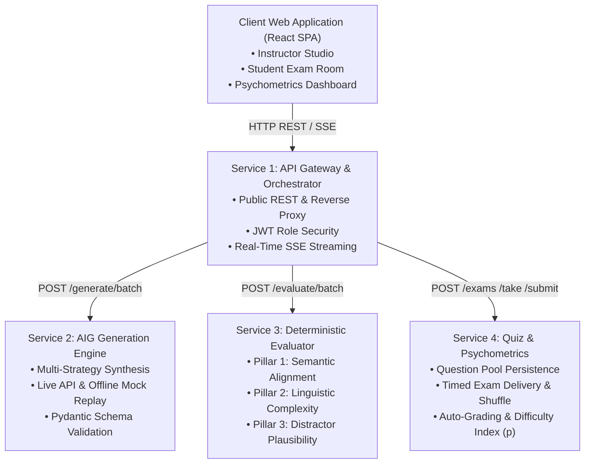
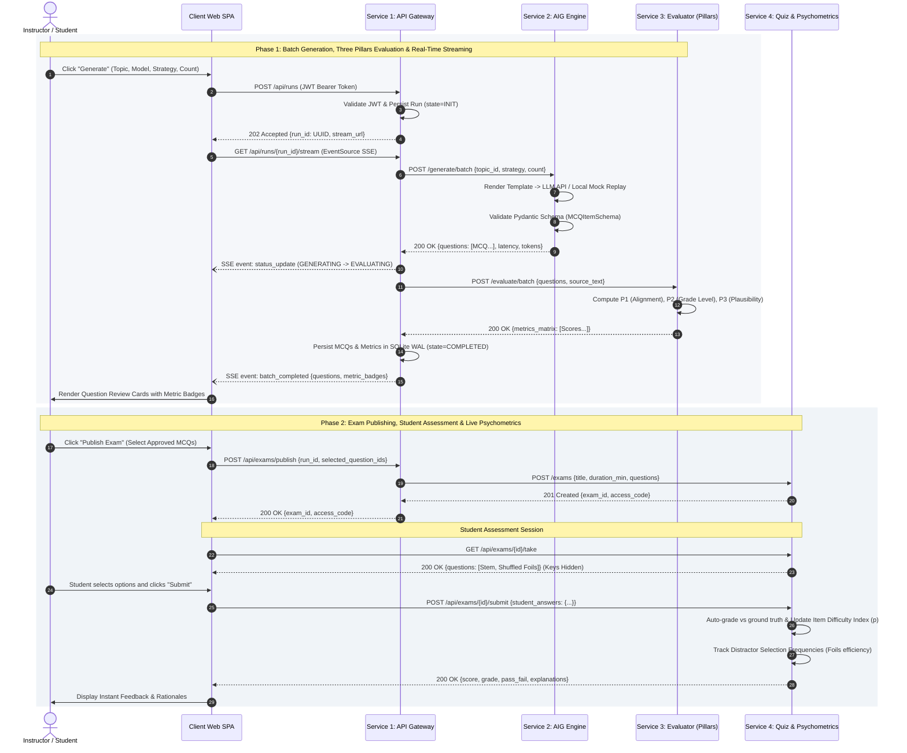

# EduGen Project Documentation

This directory contains the formal architectural specifications, functional and technical requirements, and Mermaid diagrams for **EduGen** (Programming 5 course project under Prof. Gergely Laborci).

## Documentation Index

1. **[System Specifications & Requirements (Markdown)](PROPOSAL_SPECIFICATION.md)**
   - Complete paired Functional Requirements (FR) and Technical Specifications (TR).
   - Domain-Driven Design microservices architecture.
   - Formal Mermaid flowchart and sequence diagram.
   - Docker Compose multi-container deployment parameters.
2. **[Official Word Document Proposal (`.docx`)](EduGen_Programming5_Project_Proposal_ZA0P52.docx)**
   - Formatted course project proposal document.
3. **[High-Resolution Sequence Diagram (`.png`)](sequence_diagram.png)**
   - End-to-end execution flow illustrating generation, evaluation, and student assessment.

## High-Level Architecture (Mermaid)

## System Execution Flow (Mermaid Sequence Diagram)

