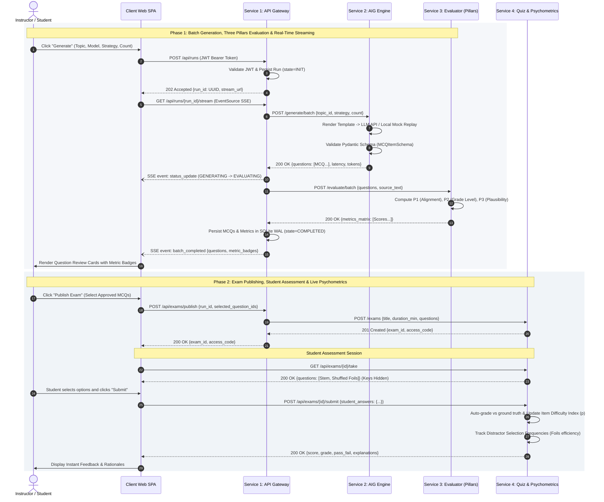

# EduGen: Distributed Microservices Platform for Automated Question Generation, Deterministic Evaluation, and Assessment Delivery

EduGen is a distributed, cloud-native microservices platform for **Automated Item Generation (AIG)** and **pedagogical quality measurement**. The platform enables computer engineering educators to synthesize curriculum-grounded Multiple-Choice Questions (MCQs), objectively evaluate them against deterministic NLP metrics ("The Three Pillars"), and deliver timed exams to students while capturing empirical psychometric response statistics in real time.

- **Author:** Storcz (Neptun: `ZA0P52`)
- **Course:** Programming 5 (*Programozás 5*), PTE MIK
- **Instructor:** Prof. Gergely Laborci
- **Current Status:** In Progress (Architecture & Specifications Defined; Microservice Scaffolding)

---

## Architecture Overview

The system consists of **4 decoupled microservices** and an interactive **Single-Page Application (SPA) client**, containerized with Docker Compose:

1. **Service 1: API Gateway & Orchestrator (`:8000`)** — Public REST entry point, JWT role-based security, batch workflow coordination, and real-time generation streaming via Server-Sent Events (SSE).
2. **Service 2: AIG Generation & Multi-Agent Engine (`:8001`)** — Prompt injection, Pydantic schema validation, and dual-mode execution (Live LLM API + 100% stable offline Mock Replay mode).
3. **Service 3: Deterministic Evaluation Service (`:8002`)** — Independent NLP engine computing *The Three Pillars*: Semantic Alignment (TF-IDF Cosine), Linguistic Complexity (Flesch-Kincaid), and Distractor Plausibility (Jaccard).
4. **Service 4: Assessment & Psychometrics Delivery (`:8003`)** — Question bank persistence, timed student exam delivery with randomized options, automated grading, and live item difficulty ($p$-value) computation.
5. **Client Web Application (`:3000`)** — Modern React/Tailwind frontend featuring an Instructor Studio (live generation stream & metric badges) and a Student Exam Room.

---

## Timeline

| Week | Goal / Milestone | Verifiable Result |
| :---: | :--- | :--- |
| **01** | Project proposal and architectural specification. | Combined Functional & Technical specification document and sequence diagram. |
| **02** | Repository setup, monorepo scaffolding, and shared contracts. | Initial Git structure matching course guidelines; Pydantic data schemas defined. |
| **03** | Service 3 (Evaluation Engine) implementation. | NLP metrics microservice with unit tests for Alignment, Grade Level, and Jaccard distance. |
| **04** | Service 2 (AIG Generator) implementation & Mock Provider. | Generative microservice supporting live model calls and deterministic local mock replay. |
| **05** | Service 1 (API Gateway) core routing and authentication. | JWT authentication middleware and reverse proxy routing to generator and evaluator. |
| **06** | Real-time Server-Sent Events (SSE) streaming in Gateway. | Gateway streams live generation and evaluation state packets to connected subscribers. |
| **07** | Service 4 (Quiz & Psychometrics) question bank & exam delivery. | Endpoints for publishing exams, taking timed quizzes, and automatic grading. |
| **08** | Psychometrics analytics implementation in Service 4. | Live computation of item difficulty ($p$-value) and distractor choice frequencies. |
| **09** | Client Single-Page Application (SPA): Instructor Studio. | React dashboard for selecting syllabus topics, initiating runs, and inspecting live badges. |
| **10** | Client SPA: Student Exam Room & Grading UI. | Interactive quiz-taking view with countdown timer, randomized options, and score review. |
| **11** | Docker Compose multi-container packaging and integration tests. | Root `docker-compose.yml` runs all 4 services + client with automated health checks. |
| **12** | Final validation, end-to-end rehearsal, and final submission. | Project submitted before the Week 12 deadline (first working day, 12:00). |

---

## GitHub Projects
- **Kanban Board:** [EduGen Project Board](https://github.com/users/username/projects/1) *(Update with your active board URL)*
- The board tracks the **Todo → In progress → Done** status of specific tasks and is accessible to the instructor.

---

## Additional Documents
All formal specifications and diagrams are maintained under the `project/docs/` directory:
- [Combined Functional & Technical Proposal Specification](docs/PROPOSAL_SPECIFICATION.md)
- [Official Word Document Proposal (`.docx`)](docs/EduGen_Programming5_Project_Proposal_ZA0P52.docx)
- [System Sequence Diagram (`.png`)](docs/sequence_diagram.png)
