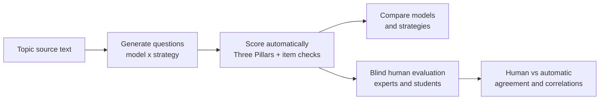

# 01 Overview

## Problem

Good multiple-choice questions need a clear stem, one correct answer and three distractors that a half-prepared
student would find tempting. Writing them by hand is slow. Language models write them quickly, but the thesis
showed that their quality depends on the model and on the prompting strategy. Each of the four compared models
leads a different quality pillar, and all of them place the correct answer mostly at A or B.

The thesis measures quality automatically with deterministic metrics. Automatic metrics are textual indicators,
though: they do not prove that the marked answer is correct, or that a question is clear and useful for students.
That needs human evaluation, which the thesis planned (functional specification UC-200 expert review and
UC-300 student quiz) but implemented only partly.

## What EduGen does

*Functional view: the research workflow.*

1. **Generate.** An operator starts an experiment: topics × models × strategies. Every cell is a job that the
   Generator processes asynchronously. Progress is streamed live to the browser.
2. **Score.** The Evaluator scores every question with the four pillars of the thesis framework and flags
   item-writing defects: key position bias, the key being the longest option, distractors too close to the key.
3. **Compare.** The Lab shows one row per model and strategy, with the band of each pillar. As in the thesis
   there is no overall score, because the pillars trade off against each other.
4. **Evaluate blind.** The operator samples questions into a study. Experts rate them on four 1–5 scales and
   judge whether the marked answer is correct. Students answer them in an anonymous quiz and rate clarity,
   helpfulness and difficulty. Neither group ever sees the model.
5. **Relate.** The Lab computes inter-rater agreement (Krippendorff's alpha), Spearman correlations between
   human judgements and the pillars, and classic item analysis (share correct, unused distractors).

## Users

| User | Uses | Access |
|---|---|---|
| Operator (researcher, instructor) | Lab: experiments, comparison, studies, analytics | Username and password |
| Expert reviewer | Expert review screen | Study code plus a pseudonym (to resume) |
| Student participant | Practice quiz | Study code; anonymous, consent notice first |

## Relation to the thesis

| Thesis element | In EduGen |
|---|---|
| Four models of 70–120B parameters, pinned to one host each | Model registry of the Generator (`services/generator/generator/models.yaml`) |
| Conditions: zero-shot baseline, prompt v2 with key balancing, verify → repair → select | Generator strategies `baseline`, `prompt_v2`, `verify_repair` |
| Three Pillars metrics (dense all-MiniLM-L6-v2 and lexical variants) with frozen band cut points | Evaluator; reproduces the stored thesis scores within 0.00005 on 60 thesis questions |
| Blind expert review (UC-200) | Review service, expert flow; agreement in the Lab |
| Student quiz with clarity, helpfulness and difficulty ratings (UC-300, not implemented in the thesis) | Review service, quiz flow; item analysis in the Lab |
| October 2026 comparison results | A public sample (108 questions, 3 topics × 4 models × 3 conditions) imported as a read-only experiment |

Out of scope: course-material retrieval (the thesis's RAG index is built from copyrighted course PDFs) and the
thesis's statistical tests (Friedman, Wilcoxon). The topic texts of the thesis are not published either,
because they were drafted from other students' notes. Live generation uses three demo topics written for this
project.
