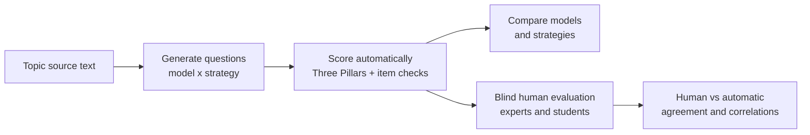

# 01 Overview

## Problem

Good multiple-choice questions need a clear stem, one correct answer and three distractors that a half-prepared
student would find tempting. Writing them by hand is slow. Language models write them quickly, but how good the
result is depends on the model and on the prompting strategy. In the prototype phase of my thesis no model was
best on every quality metric, and all four placed the correct answer mostly at A or B.

Quality can be measured automatically with deterministic text metrics. These are textual indicators, though: they
do not prove that the marked answer is correct, or that a question is clear and useful for students. That needs
people. The functional specification of the thesis describes a blind expert review (UC-200) and a student quiz
(UC-300) for this purpose. EduGen is where these two use cases are built, as services around the generation
and scoring pipeline.

## What EduGen does

*Functional view: the research workflow.*

1. **Generate.** An operator starts an experiment: topics × models × strategies. Every cell is a job that the
   Generator processes asynchronously. Progress is streamed live to the browser.
2. **Score.** The Evaluator scores every question with the four pillars of the framework and flags
   item-writing defects: key position bias, the key being the longest option, distractors too close to the key.
3. **Compare.** The Lab shows one row per model and strategy, with the band of each pillar. As in the thesis
   there is no overall score, because the pillars trade off against each other.
4. **Evaluate blind.** The operator samples questions into a study. Experts rate them on four 1–5 scales and
   judge whether the marked answer is correct. Students answer them in an anonymous quiz and rate clarity,
   helpfulness and difficulty. Neither group ever sees the model.
5. **Relate.** The Lab computes inter-rater agreement (Krippendorff's alpha), Spearman correlations between
   human judgements and the pillars, and classic item analysis for every question (share correct, unused
   distractors).

## Users

| User | Uses | Access |
|---|---|---|
| Operator (researcher, instructor) | Lab: experiments, comparison, studies, analytics | Username and password |
| Expert reviewer | Expert review screen | Study code plus a pseudonym (to resume) |
| Student participant | Practice quiz | Study code; anonymous, consent notice first |

## Relation to the thesis

My BSc thesis is *A Comparative Framework for Automated Technical Multiple-Choice Question Generation Using Large
Language Models* (University of Pécs, 2026/27). The work on it has two phases, and EduGen takes parts from both.

- **The prototype (February to October 2026)** was a Python batch pipeline. It produced the Three Pillars
  metrics with their band cut points, two prompts, a verify → repair → select pipeline and a comparison of four
  models under three conditions.
- **The thesis as re-planned on 27 October 2026** rests on one controlled experiment with a new framework,
  [aqg-framework](https://github.com/chaad404/aqg-framework): one prompt, fixed sampling settings, three
  independent runs on 35 state-exam topics, and a rating study that tests the metrics against human judgement.
  Its data and results are not part of EduGen.

| Element | Comes from | In EduGen |
|---|---|---|
| Four models of 70–120B parameters, each pinned to one host | Thesis (the same registry) | Model registry of the Generator (`services/generator/generator/models.yaml`) |
| Fixed sampling settings for every model: temperature 0.7, top_p 1.0, max_tokens 8,192, gpt-oss reasoning effort medium | Thesis protocol | Registry `defaults`, translated for each API and recorded with every job (jobs before 29 October 2026 used each provider's defaults) |
| Prompt v2: an evidence quote, ten item-writing rules, no example answer | Prototype; the thesis uses it unchanged | Strategy `prompt_v2`, and the Writer of `verify_repair` |
| Prompt v1: a zero-shot template whose only example answer is "A" | Prototype | Strategy `baseline`, kept because it shows what the example does to the key position |
| Key letters recorded as the model wrote them, then balanced in code | Thesis | `raw_answers` in every job trace; the comparison's key-position chart shows them |
| Verify → repair → select | Prototype (its pipeline v2) | Strategy `verify_repair`, with the Evaluator as the checker |
| Three Pillars metrics (dense all-MiniLM-L6-v2 and lexical variants), frozen band cut points, item-writing checks | Prototype | Evaluator; it reproduces the prototype's stored scores within 0.00005 on 60 of its questions |
| Blind expert review (UC-200) | Functional specification of the thesis | Review service, expert flow; agreement in the Lab |
| Student quiz with clarity, helpfulness and difficulty ratings (UC-300) | Functional specification of the thesis | Review service, quiz flow; item analysis in the Lab |
| October 2026 comparison: baseline, RAG, multi-agent | Prototype data | A public sample (108 questions, 3 topics × 4 models × 3 conditions) imported as a read-only experiment |

### Where EduGen differs from the thesis as it is now

EduGen keeps the prototype's quality framework, which is also what its imported sample was scored with. The
thesis has moved on in four points:

| | EduGen | Thesis |
|---|---|---|
| Alignment | Compares the question stem with the source text | Compares the stem together with the correct answer, so the tested fact is checked |
| Bands (Weak … Best) | Shown for every pillar. Their cut points are quartiles of the prototype's April 2026 question pool, so a band ranks a question against that pool; it is not an absolute grade | No bands: the metric values are reported, and the limits of "too far" and "too close" distractors are set from the human ratings |
| Output format | Asks each provider for JSON output | Requests plain text, to measure how often an endpoint writes valid JSON by itself |
| Topics | Three demo topics written for this project | 35 state-exam topics with verified reference texts, which are not public |

A number in EduGen is therefore not a result of the thesis. What EduGen adds is the system around the method:
long-running generation as queued jobs, scoring as a separate stateless service, live progress, and a blind
review whose blindness is guaranteed by data ownership.

## Out of scope

- Course-material retrieval. The prototype's RAG index is built from copyrighted course PDFs; in EduGen the RAG
  and multi-agent conditions exist only as recorded results in the imported sample.
- The statistical tests of the thesis (Friedman, Wilcoxon). The Lab's comparison is descriptive.
- The topic texts of the prototype and of the thesis. They come from other students' notes and from course
  material, so they are not published. Live generation uses the three demo topics.

What has been run so far is in [08 Results](08-results.md).
