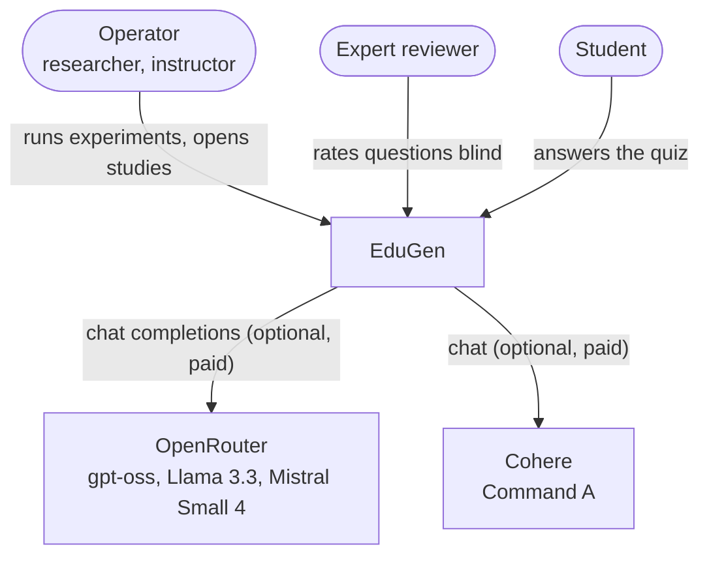
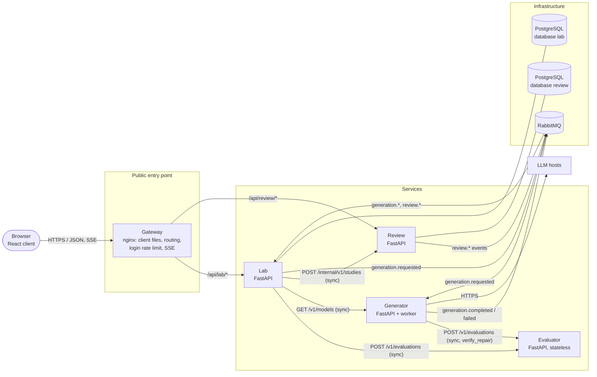
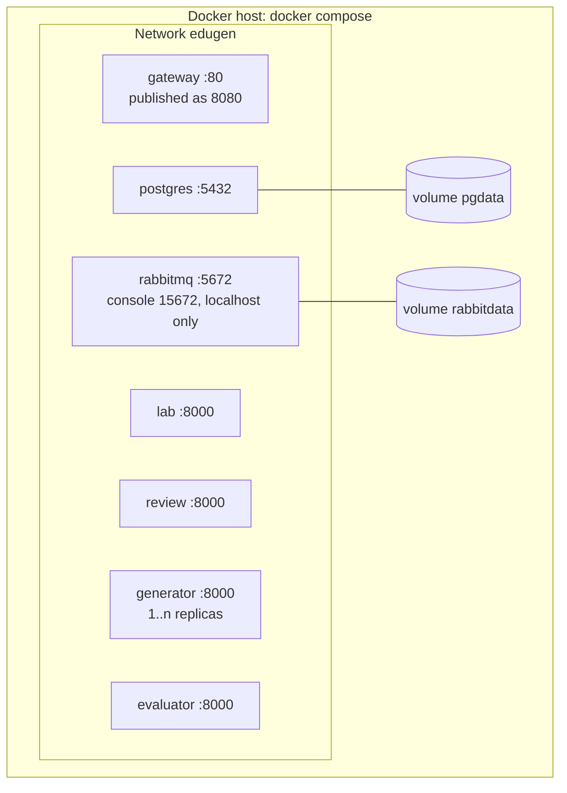

# 02 Architecture

## System context

*C4 level 1, context view.* Without API keys EduGen runs fully offline: the Generator then offers only the
labelled simulator, and the thesis results come from the imported sample.

## Containers

*C4 level 2, container view.* Solid arrows are calls (the caller waits). Message flows go through RabbitMQ:
the sender does not wait for the receiver.

## Services

| Service | Owns | Synchronous API | Messages | Why a separate service |
|---|---|---|---|---|
| **Lab** | Topics, experiments, jobs, questions with scores, studies (with the item → question mapping), human results | Operator API: experiments, comparison, studies, analytics, SSE | Publishes `generation.requested`; consumes `generation.*` and `review.*` | The research workspace and the only owner of "which model wrote which question" |
| **Generator** | Nothing persistent (model registry in configuration) | `GET /v1/models`, `/v1/strategies`, health | Consumes `generation.requested`; publishes `generation.completed` / `generation.failed` | Slow, paid, rate-limited and failure-prone external calls; scaled by adding workers; failures stay inside it |
| **Evaluator** | Nothing (stateless computation) | `POST /v1/evaluations`, `GET /v1/framework` | None | Deterministic, CPU-bound scoring with a 90 MB embedding model; needed immediately by two callers |
| **Review** | Blinded copies of study questions, participant sessions, ratings, quiz steps | Participant API: sessions, expert review, quiz; `POST /internal/v1/studies` for the Lab | Publishes `review.rating.submitted`, `review.answer.submitted`, `review.feedback.submitted` | Different users, different availability need, sensitive data; blindness is guaranteed by not having the model names at all |

Each service has its own code base under `services/`, its own tests, its own image and its own release.

## Data ownership

| Data | Owner | Others get |
|---|---|---|
| Topic texts | Lab | The Generator receives the text inside each job message (event-carried state transfer) |
| Generated questions and scores | Lab | Review receives a blinded copy (question, options, key, topic label) as a historical snapshot |
| Model and strategy of a question | Lab | Nobody. Review knows only an opaque `item_ref` |
| Ratings, answers, feedback | Review | The Lab receives them as events and keeps its own analysis copy |
| Framework cut points | Evaluator | The Lab reads them via `GET /v1/framework` (cached) to band its aggregates |

No service reads another service's database. In the deployment, one PostgreSQL server holds two databases with
two roles, and a role can connect only to its own database (`infra/postgres/init-databases.sh`).

## Deployment

*Deployment view.* Only the gateway is reachable from outside (and the RabbitMQ console from the local machine).
The Generator and Evaluator have no published ports. More Generator instances share the job queue:
`docker compose up --scale generator=3`.

## Technology

| Part | Choice |
|---|---|
| Services | Python 3.12, FastAPI, Pydantic, SQLAlchemy 2, pika (RabbitMQ), PyJWT, httpx |
| Evaluator metrics | textstat (Flesch-Kincaid), NumPy, fastembed (ONNX Runtime) with all-MiniLM-L6-v2 |
| Client | React 19, TypeScript, Vite, React Router |
| Infrastructure | nginx 1.27, PostgreSQL 17, RabbitMQ 4.1, Docker Compose |
