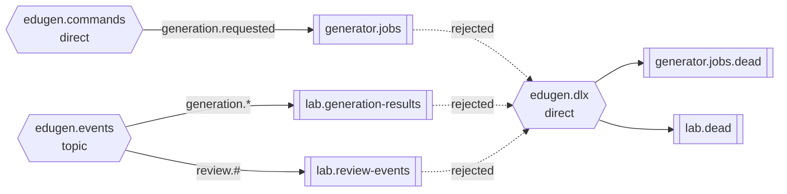
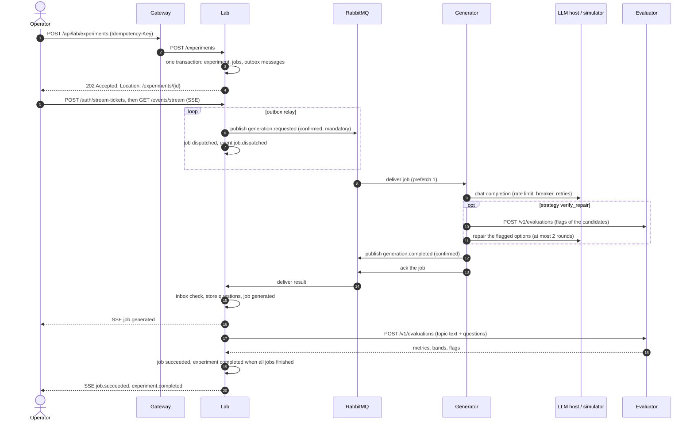
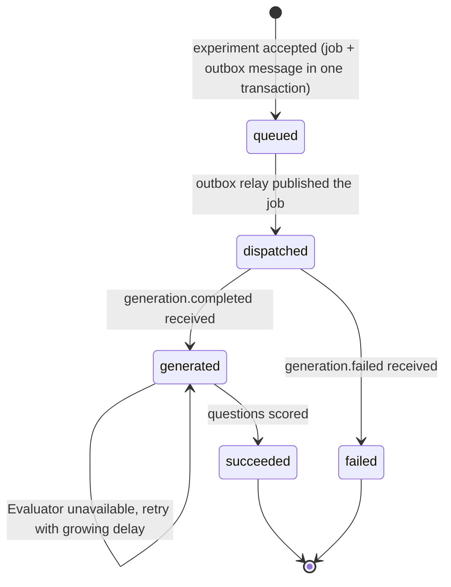
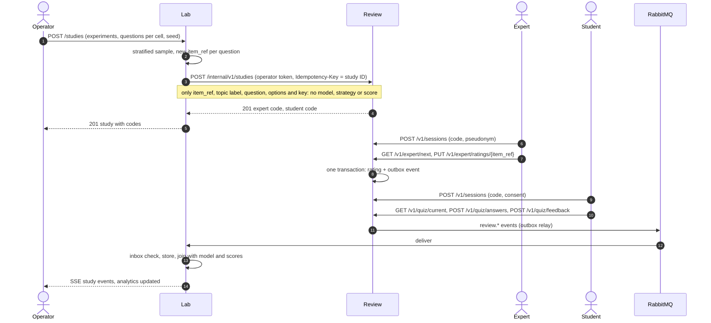
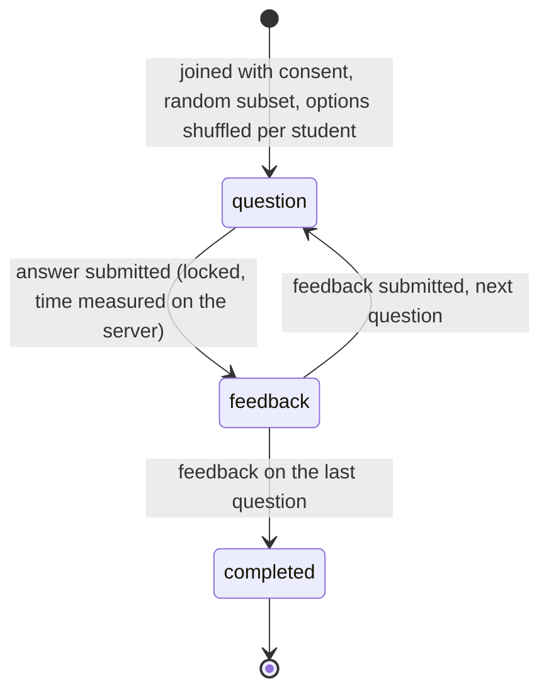

# 03 Communication and data flows

## Synchronous or asynchronous?

| Interaction | Style | Why |
|---|---|---|
| Browser → Lab, Browser → Review | Synchronous REST through the gateway | The user needs an immediate answer |
| Lab → Generator: run a job | **Asynchronous command** on a work queue | Minutes long, paid, rate-limited, fails with HTTP 429; the queue buffers it and the Generator works at the speed the hosts allow |
| Generator → Lab: job result | **Asynchronous event** | The Lab may be busy or restarting; the result waits in its queue |
| Lab → Evaluator, Generator → Evaluator | Synchronous request–response | Deterministic, about a second, and the caller cannot continue without the scores |
| Lab → Generator: model catalog | Synchronous, cached for 30 s | Needed to validate a new experiment; the last known catalog is used while the Generator is down |
| Lab → Review: create a study | Synchronous with an idempotency key | The operator needs the study codes at once; a retry is safe |
| Review → Lab: ratings, answers, feedback | **Asynchronous events** | Participants must not wait for the Lab, and the Lab may be down during a study |
| Lab → Browser: progress | **Server-Sent Events** | Data flows from the server only; the browser reconnects and resumes by itself |

## Message contract

Every message on RabbitMQ has the same envelope:

```json
{
  "message_id": "7f0c…",
  "type": "generation.requested",
  "version": 1,
  "occurred_at": "2026-10-22T14:05:11+00:00",
  "producer": "lab",
  "correlation_id": "<experiment or study ID>",
  "causation_id": "<message_id of the message that caused this one>",
  "payload": { }
}
```

| Type | Kind | Producer → consumer | Payload (main fields) |
|---|---|---|---|
| `generation.requested` | Command | Lab → Generator (queue `generator.jobs`) | `job_id`, `experiment_id`, `model`, `strategy`, `num_questions`, `topic {topic_id, title, domain, source_text}` |
| `generation.completed` | Event | Generator → Lab (queue `lab.generation-results`) | `job_id`, `items[]`, `provider`, requested and returned model ID, `simulated`, `attempts`, `calls`, tokens, `cost_usd`, `latency_seconds`, `strategy_status`, `trace` (with the sampling `settings` sent) |
| `generation.failed` | Event | Generator → Lab | `job_id`, `error_kind`, `error`, `status_code`, `attempts`, tokens spent, `cost_usd`, `provider`, requested model ID, `trace` (the `settings`) |
| `review.rating.submitted` | Event | Review → Lab (queue `lab.review-events`) | `study_id`, `item_ref`, `rater` (pseudonym), four scores, `key_correct`, `unusable`, `comment`, `revision` |
| `review.answer.submitted` | Event | Review → Lab | `study_id`, `item_ref`, `participant` (anonymous ID), `chosen` (original label), `correct`, `time_ms` |
| `review.feedback.submitted` | Event | Review → Lab | `study_id`, `item_ref`, `participant`, `clarity`, `helpfulness`, `difficulty` |

The job message carries the topic text, so the Generator needs no call back to the Lab. Results never contain
internal table rows, only the fields the consumer needs.

### Broker topology



*Messaging view.* `generator.jobs` is a work queue: each job goes to exactly one Generator instance. Events
are routed by type. A message that cannot be parsed goes to a dead-letter queue instead of being retried forever.

## Experiment run



### Job lifecycle



*State view of one job.* A job does not time out while it waits in the queue: a stopped Generator only delays
it. A duplicated result (the job ran twice) is ignored, because only `queued` and `dispatched` jobs accept one.

## Blind review study



### Student quiz flow



*State view of one quiz step.* Questions come strictly in order. A repeated identical answer is accepted
without a second effect; a different answer is rejected with 409. In the feedback step the student sees whether
the answer was right and which option is correct; the key is never sent before the answer is locked. The
clarity, helpfulness and difficulty ratings are therefore given with the correct answer known.

## Live progress (Server-Sent Events)

The Lab stores every progress event with an increasing ID. `GET /events/stream` sends them as
`id: / event: / data:` frames, a `retry: 3000` hint and a comment line every 15 seconds so that proxies do not
drop the idle connection. The browser's `EventSource` cannot send an `Authorization` header, so the client first
requests a **stream ticket**, a JWT valid for 5 minutes and for one channel only, and passes it in the URL.

After a broken connection the browser reconnects with `Last-Event-ID`, and the server continues after that event.
If the ticket has expired, the client requests a new ticket and reopens the stream with `after=<last ID>`, with
backoff and jitter. A stream closes after 15 minutes, so long-lived connections spread over instances. The
gateway forwards the stream without buffering. The same events can also be polled with `GET /events?after=<ID>`.
