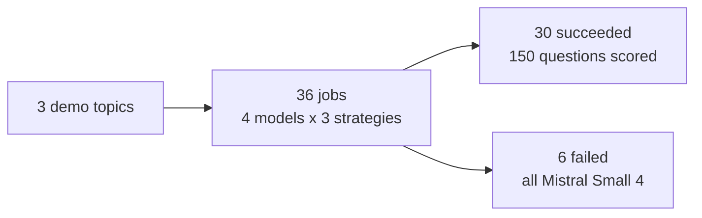

# 08 Results

What has been run with the system so far, and what the numbers show and do not show.

Everything on this page can be checked in a fresh deployment: both data sets below are imported at start-up
(see [07 Running and testing](07-running-and-testing.md)). The numbers were read from the Lab's API
(`GET /experiments/{id}/summary`, `GET /experiments/{id}`) on 12 November 2026.

**How to read it.** The runs are small: 15 questions per model and strategy at most. The tables describe
these questions; they do not rank the models. The automatic metrics describe the text of a question. They do
not show that the marked answer is right or that a question is useful, which is what the blind review is for.

## Live run of 23 October 2026

*Functional view: what happened to the 36 jobs of the run.*

| | |
|---|---|
| Design | 3 demo topics × 4 models × 3 strategies = 36 jobs, 5 questions per job |
| Outcome | 30 jobs succeeded, 6 failed; 150 questions generated and scored |
| Calls and tokens | 72 model calls, 172,855 tokens |
| Duration | 32 minutes with one Generator instance |
| Cost | $0.3066 at list prices: Command A $0.2460, Llama 3.3 $0.0294, gpt-oss $0.0290, Mistral Small 4 $0.0022 |
| Sampling settings | Each provider's defaults. The fixed settings (temperature 0.7, top_p 1.0, max_tokens 8,192) came on 29 October |
| In the Lab | Experiment *Live run of 23 October 2026: 4 models x 3 strategies on the 3 demo topics*, origin `recorded` |

### Comparison

| Model | Strategy | Questions | P1 alignment | P2 grade | P3a plausibility | P3b diversity | Flags per question | Calls per job | Seconds per job | Cost |
|---|---|---|---|---|---|---|---|---|---|---|
| gpt-oss-120b | baseline | 15 | 0.616 | 10.1 | 0.561 | 0.461 | 2.33 | 1.0 | 3.1 | $0.0020 |
| gpt-oss-120b | prompt_v2 | 15 | 0.620 | 10.0 | 0.493 | 0.603 | 2.07 | 1.0 | 4.1 | $0.0037 |
| gpt-oss-120b | verify_repair | 15 | 0.708 | 11.9 | 0.509 | 0.564 | 0.73 | 5.0 | 28.2 | $0.0233 |
| Llama 3.3 70B | baseline | 15 | 0.647 | 8.3 | 0.527 | 0.542 | 2.67 | 1.0 | 5.9 | $0.0029 |
| Llama 3.3 70B | prompt_v2 | 15 | 0.588 | 6.4 | 0.406 | 0.615 | 3.53 | 2.0 | 16.3 | $0.0065 |
| Llama 3.3 70B | verify_repair | 15 | 0.654 | 9.0 | 0.508 | 0.560 | 1.33 | 5.3 | 31.8 | $0.0200 |
| Mistral Small 4 | baseline | 5 (1 of 3 jobs) | 0.745 | 6.9 | 0.497 | 0.535 | 2.00 | 1.0 | 3.8 | $0.0005 |
| Mistral Small 4 | prompt_v2 | 0 (0 of 3 jobs) | – | – | – | – | – | – | – | $0.0000 |
| Mistral Small 4 | verify_repair | 10 (2 of 3 jobs) | 0.717 | 8.5 | 0.492 | 0.521 | 1.10 | 1.5 | 245.9 | $0.0017 |
| Command A | baseline | 15 | 0.636 | 8.8 | 0.421 | 0.606 | 2.33 | 1.0 | 51.3 | $0.0254 |
| Command A | prompt_v2 | 15 | 0.649 | 8.8 | 0.397 | 0.634 | 3.07 | 1.0 | 20.9 | $0.0302 |
| Command A | verify_repair | 15 | 0.704 | 10.3 | 0.459 | 0.575 | 1.13 | 5.3 | 187.9 | $0.1904 |

The pillar columns are means. P1, P3a and P3b are cosine-based values between 0 and 1; P2 is a school grade level
with a target zone of 10 to 14. Calls and seconds are averages over the jobs that succeeded.

### What the run shows

**1. The baseline prompt fixes the key position.** With the baseline prompt, whose only example answer is "A",
the models' own key letters were far from even:

| Model | A | B | C | D |
|---|---|---|---|---|
| gpt-oss-120b | 15 | 0 | 0 | 0 |
| Command A | 12 | 2 | 1 | 0 |
| Mistral Small 4 | 5 | 0 | 0 | 0 |
| Llama 3.3 70B | 0 | 9 | 6 | 0 |
| All four | 32 | 11 | 7 | 0 |

A student who always answers "A" would score 64% on these 50 questions. For `prompt_v2` and `verify_repair`
the stored keys are even (11, 10, 14 and 10 of 45 questions; 13, 16, 13 and 13 of 55), but that is the
Generator's own re-ordering, not a property of the models: this run did not yet record the letters the models
wrote under those two strategies.
Every job since 29 October records them (`raw_answers` in the job trace), and the Lab's key-position chart shows
them wherever they exist.

**2. Verify → repair → select removes flags, at five times the calls.** Pooled over the three models whose jobs
all succeeded (45 questions per strategy):

| Strategy | P1 alignment | P2 in the target zone | P3a plausibility | P3b diversity | Flags per question | Questions without any flag |
|---|---|---|---|---|---|---|
| baseline | 0.633 | 29% | 0.503 | 0.536 | 2.44 | 5 of 45 (11%) |
| prompt_v2 | 0.619 | 31% | 0.432 | 0.617 | 2.89 | 2 of 45 (4%) |
| verify_repair | 0.689 | 44% | 0.492 | 0.566 | 1.07 | 14 of 45 (31%) |

The job traces say how the loop got there. Of 135 candidate questions written, 3 passed every check before
repair. 92 repairs were attempted in 18 rounds, and 40 were accepted (a repair is kept only if it leaves fewer
flags). In the end 14 of the 45 selected questions passed every check, so no job reached the status
`all_passed`; all nine are `best_effort`. The price is 5.0 to 5.3 calls per job instead of 1, and 7 to 12 times
the cost of a baseline job.

This shows that the loop does what it is built to do. It does not show that the questions are better: the flags
are counted by the same checks the loop optimises. Only a measure the loop does not see, such as a human
rating, can show that.

**3. Prompt v2 moves the distractor metrics the way its rules say.** Compared with the baseline, prompt v2 gave
lower plausibility (0.432 against 0.503), higher diversity (0.617 against 0.536) and more "weak distractor"
flags (43 against 28). The baseline prompt asks for distractors that use the terminology and phrasing of the
correct answer (its example praises "high Jaccard overlap"), and the plausibility metric measures how close the
distractors are to the correct answer. Prompt v2 asks for distractors that are clearly wrong and make three
different mistakes. The metrics follow the instructions; which set a student finds harder is again a question
for people.

**4. No strategy and no model leads everywhere.** Among the groups with all their jobs, gpt-oss with
verify_repair leads alignment (0.708) and readability (73% in the target zone), gpt-oss with the baseline leads
plausibility (0.561), and Command A with prompt v2 leads diversity (0.634). Mistral's baseline group has the
highest alignment of all (0.745), but from 5 questions on one topic, so the Lab does not rank it.

**5. Cost and time differ far more than the scores.** Command A caused 80% of the cost. A single-call job took
2 to 6 seconds on gpt-oss and Llama 3.3, and between 5 and 75 seconds on Command A (36 on average); its
verify_repair jobs took three minutes on average.

**6. The bands do not transfer to other texts.** 21 of the 45 baseline questions are flagged `off_topic`
because their alignment is below 0.64. That cut point is the lowest quartile of the prototype's April 2026
question pool, measured on other and much longer topic texts. On the short demo texts it means "lower than a
typical question of that pool", not "off topic".

### What failed, and what changed because of it

All six failed jobs were Mistral Small 4 jobs. The model was then called through OpenRouter, whose shared pool for
Mistral answered HTTP 429.

| Failed jobs | Recorded as | What happened |
|---|---|---|
| 3 | `provider_error`, HTTP 429 | All 4 attempts were rejected by the host, with growing waits in between |
| 2 | `provider_error`, circuit open | After 5 failures in a row the circuit breaker stopped calling the host for 30 seconds, and these jobs fell into that window |
| 1 | `invalid_output` | A verify_repair job whose Writer calls were all rejected by the host. The kind was wrong: the host had failed, not the model |

The failures stayed inside the Generator: the Lab kept accepting results, the other 30 jobs finished, and the
experiment ended as `completed_with_failures` with each job's error visible. The run led to these changes, each
its own commit:

| Finding | Change |
|---|---|
| OpenRouter's shared Mistral pool rejects bursts | Mistral Small 4 is called through Mistral's own API, 6 requests a minute (`providers/mistral.py`) |
| Each provider used its own sampling defaults | The registry sends the same fixed settings to every real model, and every job records them |
| The balanced strategies hid the models' own key letters | Every strategy records the letters as written before the keys are balanced |
| gpt-oss cost twice its estimate, because of reasoning tokens | The estimate uses the output each model actually wrote per question, and the Lab also shows a true maximum |
| A host failure was reported as unusable model output | A verify_repair job fails as `provider_error` when its Writer calls failed at the host |
| A group with 5 questions was shown as a pillar leader | A group that lost jobs is marked and does not lead a pillar |

One clean re-run with these changes is the next step. Its questions will have the fixed settings and the models'
own key letters for all three strategies.

## Sample of the thesis prototype (October 2026)

108 questions from the prototype's comparison of 19 October 2026: 3 topics × 4 models × 3 conditions (baseline,
RAG, multi-agent), 9 questions per group, with the scores the prototype recorded. In the Lab it is the experiment
*Thesis prototype: October 2026 comparison (public sample)*, origin `thesis_import`.

- **Each pillar has a different leader:** alignment Mistral Small 4 with multi-agent (0.712), readability
  Command A with multi-agent (67% in the target zone), plausibility gpt-oss with the baseline (0.595), diversity
  Mistral Small 4 with RAG (0.630).
- **The keys sit at A and B:** A 56, B 33, C 14, D 5, so 82% of the keys are at A or B. gpt-oss with RAG put all
  9 keys at A.

All three conditions used the prototype's first prompt (the one with the example answer "A") and each provider's
default sampling settings. For these reasons the thesis no longer uses this data as evidence; it was re-planned
around one controlled run with its own framework ([01 Overview](01-overview.md#relation-to-the-thesis)). In EduGen
the sample is realistic data for the comparison view and for review studies, at no cost.

## Human evaluation

No study with real participants has been run yet. What exists:

- The Lab computes inter-rater agreement (Krippendorff's alpha), Spearman correlations between human judgements
  and the pillars, and the item analysis of quiz answers. Tests check the alpha against the published reference
  example (0.743) and the item analysis on known answers.
- `scripts/simulate_study.py` fills a study with simulated raters and students through the public API. It shows
  the whole path (Review → RabbitMQ → Lab → study page) and all analytics with data, but its judgements are made
  up and ignore the automatic scores. Whatever agreement or correlation it prints says nothing about the
  questions.

A pilot with a few reviewers and students is planned for week 11. Its results will be added here, with the
number of raters and questions, because agreement needs at least two raters per question and a correlation needs
at least five questions with both values.
