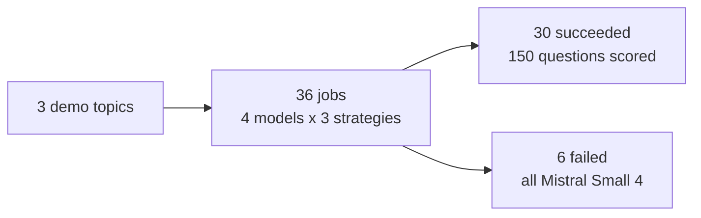
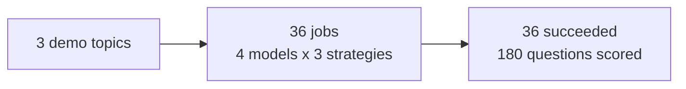
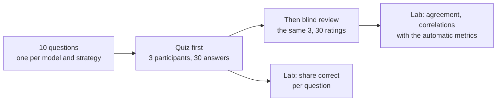

# 08 Results

What has been run with the system so far, and what the numbers show and do not show.

The three data sets below can be checked in a fresh deployment, because they are imported at start-up
(see [07 Running and testing](07-running-and-testing.md)). Their numbers were read from the Lab's API
(`GET /experiments/{id}/summary`, `GET /experiments/{id}`, `GET /experiments/{id}/items`) on 12 November 2026,
and on 15 November 2026 for the clean re-run. The [pilot study with people](#human-evaluation) is the exception:
its ratings and answers exist only in the database of the machine that ran it, and its numbers were read from
`GET /studies/{id}/analytics` and the Review service's records on 17 November 2026.

**How to read it.** The runs are small: 15 questions per model and strategy at most. The tables describe
these questions; they do not rank the models. The automatic metrics describe the text of a question. They do
not show that the marked answer is right or that a question is useful, which is what the blind review is for.

## Live run of 23 October 2026

*Functional view: what happened to the 36 jobs of the run.*

| | |
|---|---|
| Design | 3 demo topics × 4 models × 3 strategies = 36 jobs, 5 questions per job |
| Outcome | 30 jobs succeeded, 6 failed; 150 questions generated and scored |
| Calls and tokens | 72 model calls, 172,855 tokens |
| Duration | 32 minutes with one Generator instance |
| Cost | $0.3066 at list prices: Command A $0.2460, Llama 3.3 $0.0294, gpt-oss $0.0290, Mistral Small 4 $0.0022 |
| Sampling settings | Each provider's defaults. The fixed settings (temperature 0.7, top_p 1.0, max_tokens 8,192) came on 29 October |
| In the Lab | Experiment *Live run of 23 October 2026: 4 models x 3 strategies on the 3 demo topics*, origin `recorded` |

### Comparison

| Model | Strategy | Questions | P1 alignment | P2 grade | P3a plausibility | P3b diversity | Flags per question | Calls per job | Seconds per job | Cost |
|---|---|---|---|---|---|---|---|---|---|---|
| gpt-oss-120b | baseline | 15 | 0.616 | 10.1 | 0.561 | 0.461 | 2.33 | 1.0 | 3.1 | $0.0020 |
| gpt-oss-120b | prompt_v2 | 15 | 0.620 | 10.0 | 0.493 | 0.603 | 2.07 | 1.0 | 4.1 | $0.0037 |
| gpt-oss-120b | verify_repair | 15 | 0.708 | 11.9 | 0.509 | 0.564 | 0.73 | 5.0 | 28.2 | $0.0233 |
| Llama 3.3 70B | baseline | 15 | 0.647 | 8.3 | 0.527 | 0.542 | 2.67 | 1.0 | 5.9 | $0.0029 |
| Llama 3.3 70B | prompt_v2 | 15 | 0.588 | 6.4 | 0.406 | 0.615 | 3.53 | 2.0 | 16.3 | $0.0065 |
| Llama 3.3 70B | verify_repair | 15 | 0.654 | 9.0 | 0.508 | 0.560 | 1.33 | 5.3 | 31.8 | $0.0200 |
| Mistral Small 4 | baseline | 5 (1 of 3 jobs) | 0.745 | 6.9 | 0.497 | 0.535 | 2.00 | 1.0 | 3.8 | $0.0005 |
| Mistral Small 4 | prompt_v2 | 0 (0 of 3 jobs) | – | – | – | – | – | – | – | $0.0000 |
| Mistral Small 4 | verify_repair | 10 (2 of 3 jobs) | 0.717 | 8.5 | 0.492 | 0.521 | 1.10 | 1.5 | 245.9 | $0.0017 |
| Command A | baseline | 15 | 0.636 | 8.8 | 0.421 | 0.606 | 2.33 | 1.0 | 51.3 | $0.0254 |
| Command A | prompt_v2 | 15 | 0.649 | 8.8 | 0.397 | 0.634 | 3.07 | 1.0 | 20.9 | $0.0302 |
| Command A | verify_repair | 15 | 0.704 | 10.3 | 0.459 | 0.575 | 1.13 | 5.3 | 187.9 | $0.1904 |

The pillar columns are means. P1, P3a and P3b are cosine-based values between 0 and 1; P2 is a school grade level
with a target zone of 10 to 14. Calls and seconds are averages over the jobs that succeeded.

### What the run shows

**1. The baseline prompt fixes the key position.** With the baseline prompt, whose only example answer is "A",
the models' own key letters were far from even:

| Model | A | B | C | D |
|---|---|---|---|---|
| gpt-oss-120b | 15 | 0 | 0 | 0 |
| Command A | 12 | 2 | 1 | 0 |
| Mistral Small 4 | 5 | 0 | 0 | 0 |
| Llama 3.3 70B | 0 | 9 | 6 | 0 |
| All four | 32 | 11 | 7 | 0 |

A student who always answers "A" would score 64% on these 50 questions. For `prompt_v2` and `verify_repair`
the stored keys are even (11, 10, 14 and 10 of 45 questions; 13, 16, 13 and 13 of 55), but that is the
Generator's own re-ordering, not a property of the models: this run did not yet record the letters the models
wrote under those two strategies.
Every job since 29 October records them (`raw_answers` in the job trace), and the Lab's key-position chart shows
them wherever they exist.

**2. Verify → repair → select removes flags, at five times the calls.** Pooled over the three models whose jobs
all succeeded (45 questions per strategy):

| Strategy | P1 alignment | P2 in the target zone | P3a plausibility | P3b diversity | Flags per question | Questions without any flag |
|---|---|---|---|---|---|---|
| baseline | 0.633 | 29% | 0.503 | 0.536 | 2.44 | 5 of 45 (11%) |
| prompt_v2 | 0.619 | 31% | 0.432 | 0.617 | 2.89 | 2 of 45 (4%) |
| verify_repair | 0.689 | 44% | 0.492 | 0.566 | 1.07 | 14 of 45 (31%) |

The job traces say how the loop got there. Of 135 candidate questions written, 3 passed every check before
repair. 92 repairs were attempted in 18 rounds, and 40 were accepted (a repair is kept only if it leaves fewer
flags). In the end 14 of the 45 selected questions passed every check, so no job reached the status
`all_passed`; all nine are `best_effort`. The price is 5.0 to 5.3 calls per job instead of 1, and 7 to 12 times
the cost of a baseline job.

This shows that the loop does what it is built to do. It does not show that the questions are better: the flags
are counted by the same checks the loop optimises. Only a measure the loop does not see, such as a human
rating, can show that.

**3. Prompt v2 moves the distractor metrics the way its rules say.** Compared with the baseline, prompt v2 gave
lower plausibility (0.432 against 0.503), higher diversity (0.617 against 0.536) and more "weak distractor"
flags (43 against 28). The baseline prompt asks for distractors that use the terminology and phrasing of the
correct answer (its example praises "high Jaccard overlap"), and the plausibility metric measures how close the
distractors are to the correct answer. Prompt v2 asks for distractors that are clearly wrong and make three
different mistakes. The metrics follow the instructions; which set a student finds harder is again a question
for people.

**4. No strategy and no model leads everywhere.** Among the groups with all their jobs, gpt-oss with
verify_repair leads alignment (0.708) and readability (73% in the target zone), gpt-oss with the baseline leads
plausibility (0.561), and Command A with prompt v2 leads diversity (0.634). Mistral's baseline group has the
highest alignment of all (0.745), but from 5 questions on one topic, so the Lab does not rank it.

**5. Cost and time differ far more than the scores.** Command A caused 80% of the cost. A single-call job took
2 to 6 seconds on gpt-oss and Llama 3.3, and between 5 and 75 seconds on Command A (36 on average); its
verify_repair jobs took three minutes on average.

**6. The bands do not transfer to other texts.** 21 of the 45 baseline questions are flagged `off_topic`
because their alignment is below 0.64. That cut point is the lowest quartile of the prototype's April 2026
question pool, measured on other and much longer topic texts. On the short demo texts it means "lower than a
typical question of that pool", not "off topic".

### What failed, and what changed because of it

All six failed jobs were Mistral Small 4 jobs. The model was then called through OpenRouter, whose shared pool for
Mistral answered HTTP 429.

| Failed jobs | Recorded as | What happened |
|---|---|---|
| 3 | `provider_error`, HTTP 429 | All 4 attempts were rejected by the host, with growing waits in between |
| 2 | `provider_error`, circuit open | After 5 failures in a row the circuit breaker stopped calling the host for 30 seconds, and these jobs fell into that window |
| 1 | `invalid_output` | A verify_repair job whose Writer calls were all rejected by the host. The kind was wrong: the host had failed, not the model |

The failures stayed inside the Generator: the Lab kept accepting results, the other 30 jobs finished, and the
experiment ended as `completed_with_failures` with each job's error visible. The run led to these changes, each
its own commit:

| Finding | Change |
|---|---|
| OpenRouter's shared Mistral pool rejects bursts | Mistral Small 4 is called through Mistral's own API, 6 requests a minute (`providers/mistral.py`) |
| Each provider used its own sampling defaults | The registry sends the same fixed settings to every real model, and every job records them |
| The balanced strategies hid the models' own key letters | Every strategy records the letters as written before the keys are balanced |
| gpt-oss cost twice its estimate, because of reasoning tokens | The estimate uses the output each model actually wrote per question, and the Lab also shows a true maximum |
| A host failure was reported as unusable model output | A verify_repair job fails as `provider_error` when its Writer calls failed at the host |
| A group with 5 questions was shown as a pillar leader | A group that lost jobs is marked and does not lead a pillar |

The clean re-run of 15 November has all of these changes.

## Clean re-run of 15 November 2026

*Functional view: what happened to the 36 jobs of the re-run.*

| | |
|---|---|
| Design | The same as on 23 October: 3 demo topics × 4 models × 3 strategies = 36 jobs, 5 questions per job |
| Outcome | 36 jobs succeeded; 180 questions generated and scored |
| Calls and tokens | 88 model calls, 207,012 tokens |
| Duration | 10 minutes with one Generator instance |
| Cost | $0.3078 at list prices; the Lab's estimate before the start was $0.3141, with a true maximum of $9.47. Command A $0.2367, gpt-oss $0.0301, Llama 3.3 $0.0280, Mistral Small 4 $0.0131 |
| Sampling settings | The same for every model and recorded in every job: temperature 0.7, top_p 1.0, max_tokens 8,192; gpt-oss with reasoning effort medium |
| Mistral Small 4 | Through Mistral's own API at 6 requests a minute: 9 of 9 jobs, each call answered at the first attempt |
| In the Lab | Experiment *Clean re-run of 15 November 2026: 4 models x 3 strategies on the 3 demo topics*, origin `recorded` |

### Comparison

| Model | Strategy | Questions | P1 alignment | P2 grade | P3a plausibility | P3b diversity | Flags per question | Calls per job | Seconds per job | Cost |
|---|---|---|---|---|---|---|---|---|---|---|
| gpt-oss-120b | baseline | 15 | 0.627 | 10.0 | 0.542 | 0.488 | 2.53 | 1.0 | 3.3 | $0.0028 |
| gpt-oss-120b | prompt_v2 | 15 | 0.648 | 9.5 | 0.525 | 0.510 | 2.93 | 1.0 | 4.7 | $0.0044 |
| gpt-oss-120b | verify_repair | 15 | 0.696 | 11.1 | 0.539 | 0.556 | 0.53 | 5.0 | 28.0 | $0.0230 |
| Llama 3.3 70B | baseline | 15 | 0.637 | 9.2 | 0.494 | 0.565 | 2.67 | 1.0 | 5.8 | $0.0030 |
| Llama 3.3 70B | prompt_v2 | 15 | 0.604 | 5.8 | 0.421 | 0.638 | 3.47 | 1.3 | 7.7 | $0.0043 |
| Llama 3.3 70B | verify_repair | 15 | 0.629 | 8.2 | 0.498 | 0.599 | 1.73 | 6.0 | 33.4 | $0.0207 |
| Mistral Small 4 | baseline | 15 | 0.633 | 9.7 | 0.466 | 0.509 | 1.67 | 1.0 | 3.9 | $0.0015 |
| Mistral Small 4 | prompt_v2 | 15 | 0.628 | 10.3 | 0.603 | 0.440 | 2.00 | 1.0 | 10.5 | $0.0019 |
| Mistral Small 4 | verify_repair | 15 | 0.706 | 10.9 | 0.558 | 0.537 | 1.00 | 5.0 | 50.1 | $0.0098 |
| Command A | baseline | 15 | 0.620 | 10.2 | 0.402 | 0.641 | 2.47 | 1.0 | 5.8 | $0.0252 |
| Command A | prompt_v2 | 15 | 0.633 | 8.4 | 0.454 | 0.620 | 3.53 | 1.0 | 9.4 | $0.0307 |
| Command A | verify_repair | 15 | 0.722 | 10.4 | 0.519 | 0.527 | 1.20 | 5.0 | 42.7 | $0.1808 |

### What the re-run shows

**1. The baseline prompt fixes the key position again.** With the fixed settings, the models' own key letters
under the baseline prompt were:

| Model | A | B | C | D |
|---|---|---|---|---|
| gpt-oss-120b | 15 | 0 | 0 | 0 |
| Mistral Small 4 | 15 | 0 | 0 | 0 |
| Command A | 10 | 3 | 2 | 0 |
| Llama 3.3 70B | 0 | 7 | 7 | 1 |
| All four | 40 | 10 | 9 | 1 |

A student who always answers "A" would score 67% on these 60 questions (64% on 23 October). The pattern of the
first run came back model by model: gpt-oss always at A, Command A mostly at A, Llama never at A. Mistral, which
had only 5 baseline questions on 23 October, also put every key at A.

**2. Asking for an even spread is not enough.** Prompt v2 says "Spread the correct answers over the positions A,
B, C and D", and the Writer of verify_repair uses the same prompt. This run is the first that recorded the letters
the models wrote under it:

| Strategy | A | B | C | D |
|---|---|---|---|---|
| baseline (prompt v1) | 40 | 10 | 9 | 1 |
| prompt_v2 | 7 | 34 | 14 | 5 |
| verify_repair (Writer with prompt v2) | 15 | 26 | 15 | 4 |

The instruction moves the keys away from A, mostly to B, and D stays rare (9 of 120). Only gpt-oss came close to
an even spread (3, 6, 3 and 3 under prompt v2); Llama, Mistral and Command A put 9 or 10 of their 15 prompt-v2
keys at B. The Generator re-orders the options afterwards, so the stored keys of both strategies are balanced, and
these numbers show why that step is needed. The thesis does the same: it records the letters as written and then
rebalances them.

**3. Verify → repair → select removes flags again.** Pooled over all four models, 60 questions per strategy:

| Strategy | P1 alignment | P2 in the target zone | P3a plausibility | P3b diversity | Flags per question | Questions without any flag |
|---|---|---|---|---|---|---|
| baseline | 0.629 | 32% | 0.476 | 0.550 | 2.33 | 4 of 60 (7%) |
| prompt_v2 | 0.628 | 33% | 0.501 | 0.552 | 2.98 | 2 of 60 (3%) |
| verify_repair | 0.688 | 48% | 0.528 | 0.555 | 1.12 | 23 of 60 (38%) |

Of 175 candidate questions written, 7 passed every check before repair. 124 repairs were attempted in 24 rounds,
and 62 were accepted. 23 of the 60 selected questions passed every check, and for the first time one job reached
`all_passed` (gpt-oss on linear time-invariant systems). The price is again 5 to 6 calls per job and 7 to 8 times
the cost of a baseline job. The reservation of the first run still applies: the flags are counted by the checks
the loop optimises.

**4. The effect of prompt v2 on the distractor metrics did not hold.** On 23 October prompt v2 gave lower
plausibility and higher diversity (finding 3 of the first run). For the same three models the direction came
back, with more "weak distractor" flags (47 against 33), but the differences were much smaller: plausibility
0.467 against 0.479 instead of 0.432 against 0.503, diversity 0.589 against 0.564 instead of 0.617 against 0.536.
Mistral Small 4, which had no prompt-v2 questions on 23 October, went the other way (plausibility 0.603 against
0.466). With 15 questions per group an effect of this size can change between two runs; measuring it needs the
larger, topic-paired design of the thesis.

**5. The leaders changed.** All groups are complete this time. Command A with verify_repair leads alignment
(0.722), gpt-oss with verify_repair leads readability (67% in the target zone, as on 23 October), Mistral with
prompt v2 leads plausibility (0.603) and Command A with the baseline leads diversity (0.641). Three of the four
leaders differ from the first run of the same design, which is what "the tables do not rank the models" means in
practice.

**6. Faster, and as cheap as estimated.** The run took 10 minutes instead of 32: Mistral no longer waited for a
host that rejected it, and Command A answered single calls in 5 to 12 seconds (5 to 75 on 23 October). The cost
was 2% below the estimate shown before the start. gpt-oss, which cost twice its estimate on 23 October, came within
4% of it ($0.0301 against $0.0291). Command A again caused most of the cost (77%).

**7. The off-topic band still does not fit the short texts.** 30 of the 60 baseline questions are flagged
`off_topic` (21 of 45 on 23 October), for the reason given in finding 6 of the first run.

## Sample of the thesis prototype (October 2026)

108 questions from the prototype's comparison of 19 October 2026: 3 topics × 4 models × 3 conditions (baseline,
RAG, multi-agent), 9 questions per group, with the scores the prototype recorded. In the Lab it is the experiment
*Thesis prototype: October 2026 comparison (public sample)*, origin `thesis_import`.

- **Each pillar has a different leader:** alignment Mistral Small 4 with multi-agent (0.712), readability
  Command A with multi-agent (67% in the target zone), plausibility gpt-oss with the baseline (0.595), diversity
  Mistral Small 4 with RAG (0.630).
- **The keys sit at A and B:** A 56, B 33, C 14, D 5, so 82% of the keys are at A or B. gpt-oss with RAG put all
  9 keys at A.

All three conditions used the prototype's first prompt (the one with the example answer "A") and each provider's
default sampling settings. For these reasons the thesis no longer uses this data as evidence; it was re-planned
around one controlled run with its own framework ([01 Overview](01-overview.md#relation-to-the-thesis)). In EduGen
the sample is realistic data for the comparison view and for review studies, at no cost.

## Human evaluation

The Lab computes inter-rater agreement (Krippendorff's alpha), Spearman correlations between human judgements and
the pillars, and the item analysis of quiz answers; tests check the alpha against the published reference example
(0.743). `scripts/simulate_study.py` fills a study with simulated participants to show the flow, and its numbers
say nothing about the questions. The only study with people so far is the pilot below.

### Pilot study with people, 15 and 17 November 2026

*Functional view: the order of a pilot session and what the Lab computed from it.*

| | |
|---|---|
| Questions | One question per model and strategy from the live run of 23 October on REST-style HTTP APIs: 10 questions, because Mistral Small 4 has only verify_repair questions on this topic. The study was created on 14 November, before the clean re-run existed |
| Participants | Three people, in three sessions (15 November twice, 17 November). Each took the quiz first and then rated the same questions as a reviewer, so they had seen the marked answers when they rated |
| Setting | EduGen ran on the author's laptop; the participants opened the study's two links in their browsers |
| Time | Measured from joining to the last answer or rating: the quiz took 2½ to 8½ minutes per person (22 seconds per answer on average), the review 2 to 4 minutes |
| Data | 30 ratings, 30 quiz answers and 30 feedback forms, all of which reached the Lab. One further quiz session was opened and left without an answer |
| In the Lab | Study *Pilot with people, 15 November 2026: REST-style HTTP APIs from the live run of 23 October*. Its data exists only in the database of the machine that ran it, so a fresh deployment does not contain it |

The expert columns are means of the three reviewers on the 1–5 scales of the review page; "wrong options" is
the scale from "obviously wrong" (1) to "tempting" (5).

| Model | Strategy | Accuracy and relevance | Clarity | Difficulty | Wrong options | Marked answer correct | Students correct |
|---|---|---|---|---|---|---|---|
| gpt-oss-120b | baseline | 4.0 | 4.0 | 3.3 | 5.0 | 3 yes | 2 of 3 |
| gpt-oss-120b | prompt_v2 | 4.0 | 4.0 | 1.7 | 4.0 | 3 yes | 3 of 3 |
| gpt-oss-120b | verify_repair | 4.3 | 3.7 | 3.7 | 4.7 | 1 yes, 2 unsure | 0 of 3 |
| Llama 3.3 70B | baseline | 4.7 | 4.3 | 3.7 | 4.0 | 3 yes | 3 of 3 |
| Llama 3.3 70B | prompt_v2 | 4.7 | 4.0 | 3.0 | 3.7 | 3 yes | 2 of 3 |
| Llama 3.3 70B | verify_repair | 4.0 | 4.0 | 1.7 | 4.0 | 3 yes | 1 of 3 |
| Mistral Small 4 | verify_repair | 4.0 | 3.3 | 3.3 | 3.7 | 2 yes, 1 unsure | 3 of 3 |
| Command A | baseline | 4.3 | 4.0 | 4.0 | 4.7 | 2 yes, 1 unsure | 2 of 3 |
| Command A | prompt_v2 | 4.3 | 4.0 | 3.0 | 5.0 | 2 yes, 1 unsure | 0 of 3 |
| Command A | verify_repair | 4.0 | 4.3 | 1.7 | 4.3 | 3 yes | 3 of 3 |

In the quiz, 19 of the 30 answers were correct. After each answer the students rated the question: clarity 4.2,
helpfulness for exam preparation 3.6 and difficulty 3.3 on average.

| Reviewer scale | Krippendorff's alpha | Questions where all three ratings lie within one point |
|---|---|---|
| Accuracy and relevance | −0.29 | 4 of 10 |
| Clarity | −0.29 | 3 of 10 |
| Difficulty | 0.67 | 9 of 10 |
| Wrong options | 0.42 | 9 of 10 |
| Marked answer correct | – (nobody answered "no", so there is no variation to agree on) | – |

| Human judgement | Automatic metric | Spearman's rho (10 questions) |
|---|---|---|
| Reviewers: accuracy and relevance | P1 alignment | −0.09 |
| Reviewers: wrong options | P3a plausibility | −0.45 |
| Reviewers: wrong options | P3b diversity | 0.83 |
| Reviewers: difficulty | P2 grade | 0.07 |
| Students: share correct | P3a plausibility | 0.20 |
| Students: rated difficulty | P2 grade | 0.39 |

With 10 questions, a rho must be larger than about 0.65 in either direction to differ from zero at the usual 5%
level. Only one value is.

### What the pilot shows

**1. The evaluation path works with people.** Every rating, answer and feedback form went from the Review service
through RabbitMQ to the Lab, the participants could not see which model wrote a question, and the study page
computed every analysis. The session plan needed one correction, found while preparing it: two reviewers with the
same pseudonym continue one and the same session.

**2. No reviewer found a wrong key.** Of the 30 judgements of the marked answer, 25 were "yes", 5 "unsure" and
none "no". No question was marked unusable, and nobody wrote a comment.

**3. The human results point at a gap that the automatic checks missed.** The gpt-oss verify_repair question asks
which status code a server returns when the ETag in If-None-Match matches, without naming the request method.
RFC 9110 (section 13.1.2) prescribes 304 Not Modified for GET and HEAD and 412 Precondition Failed for every other
method. The key is 304; two of the three students chose the 412 option, and two of the three reviewers were unsure
about the key. The question had no flag at all. This is what finding 2 of the first run means in practice: the
repair loop satisfies the checks it is given, and only people see what the checks do not measure.

**4. The other question that nobody answered correctly is about the same subject.** Command A's prompt-v2 question
asks which header protects against lost updates. The key, If-Match, is right, and the reviewers confirmed it (two
yes, one unsure), but all three students chose Retry-After. Both questions are about conditional requests, so the
two results may say more about what these three participants knew than about the questions. Here the Evaluator
had flagged the question: its evidence quote is at least as close to options B and C as to the key
(`evidence_supports:B,C`), and C is the option all three students chose. This is one question, so it shows that
the check can point at a tempting option, not how often it does.

**5. The reviewers agreed on difficulty, not on accuracy and clarity.** An alpha of 0.667 is the usual lowest
value from which tentative conclusions are drawn; only difficulty reaches it. On accuracy and clarity the ratings
of six or seven questions lay two or more points apart, and the alpha is below zero, so the three reviewers did
not agree beyond chance. Ratings given in 10 to 20 seconds per question, by three people, are a weak measure of
accuracy.

**6. How tempting the reviewers found the wrong options followed P3b diversity, not P3a plausibility.** The more
the distractors of a question differed from each other (P3b), the more tempting the reviewers found them
(rho 0.83), and they tended to find them less tempting the closer they were to the key (P3a, rho −0.45). P3a
assumes the opposite: that a distractor close to the key is plausible, which is also what the baseline prompt asks
for. With 10 questions and three reviewers this is a lead for the thesis's rating study, not a result.

**7. Three answers per question decide only the extremes.** With three answers a question is either "too easy"
(all correct: 4 questions) or "too hard" (none correct: 2 questions) or neither, and an "unused option" was shown
for every question, because with three answers some wrong option almost always stays unchosen. The Lab now judges
unused options only from 20 answers on.

What the pilot does not show is which model or strategy writes better questions: there was one question per
model and strategy, one topic and three people.

### What changed because of the pilot

| Finding | Change |
|---|---|
| Two reviewers with the same pseudonym share one set of ratings (found while preparing the sessions) | The review page asks for a pseudonym that nobody else in the study uses, and the running guide says that each participant needs a browser of their own |
| Every question showed an unused option after three answers | A wrong option counts as unused only from 20 answers on |
| No session with people had been timed | The running guide gives the measured times |
