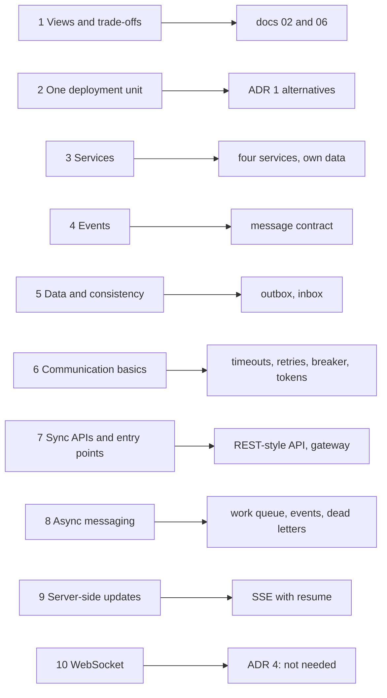

# 09 Course concepts in the code

Where the ideas of the Programming 5 course appear in EduGen, chapter by chapter, and which ones are
deliberately not used. Paths are relative to `project/`.

*Map view: course chapter → where to look.*

## 1. Views and trade-offs

| Concept | In EduGen |
|---|---|
| Three views: code, runtime, deployment | Code: one folder per service under `services/`. Runtime and deployment: the container and deployment diagrams in [02 Architecture](02-architecture.md) |
| Each diagram answers one question and names its view | Every Mermaid diagram in `docs/` has a caption with its view |
| Quality aspects instead of "best architecture" | [ADR 1](06-decisions.md) argues each service boundary with one aspect: failure handling, scaling, data management, security |
| Data owner: one writer per piece of data | Data ownership table in 02; two databases with two roles, `infra/postgres/init-databases.sh` |
| Architecture decision records | [06 Decisions](06-decisions.md): situation, alternatives, decision, consequences and a checkable review condition for each |

## 2. One deployment unit

| Concept | In EduGen |
|---|---|
| Monolith first, modular monolith as a real option | ADR 1 lists the modulith and the service-based style as alternatives, and names the condition for merging Lab and Generator again |
| Ports and adapters | `services/generator/generator/providers/`: one adapter per model API behind the same `chat()` call; the Evaluator's `Embedder` protocol; every `create_app()` takes its clients as parameters, which is how the tests replace them |

## 3. Split into services

| Concept | In EduGen |
|---|---|
| A service owns its data and is deployed on its own | Four images, four test suites; no service reads another service's database |
| Signs of a distributed monolith, avoided | No long synchronous chain: generation is a queued job. No shared tables. A stopped Generator or Evaluator delays work but stops nothing else ([05](05-reliability-and-security.md)) |
| The price of the split | ADR 1, consequences: network calls, eventual consistency, a broker, outbox and inbox |

## 4. Event-driven architecture

| Concept | In EduGen |
|---|---|
| Command or event | `generation.requested` is a command to one consumer; `generation.completed`, `generation.failed` and `review.*` are events, facts that already happened ([03](03-communication.md)) |
| Event-carried state transfer | The job message carries the topic text, so the Generator never calls back to the Lab (`services/lab/lab/orchestration.py`, `create_experiment`) |
| Event contract: type, ID, version | One envelope for every message, `services/lab/lab/messages.py` |
| A read model fed by events | The Lab keeps its own copy of ratings and answers for the analytics, written by an idempotent consumer (`services/lab/lab/studies.py`, `handle_review_event`) |

## 5. Data and consistency

| Concept | In EduGen |
|---|---|
| Database per service | One PostgreSQL server, the databases `lab` and `review`, a role each ([ADR 6](06-decisions.md)) |
| Eventual consistency, made visible | Jobs are `queued`, `dispatched`, `generated` before they are `succeeded`; a study can be a `draft`; the client shows these states instead of hiding them |
| Dual write, solved by a transactional outbox | `services/lab/lab/outbox.py`, `services/review/review/outbox.py`: the change and its message in one transaction, a relay publishes afterwards |
| Inbox: the effect of a message happens once | `_claim` in `services/lab/lab/orchestration.py`, table `inbox` with the message ID as primary key |
| Historical snapshot | The Review service keeps its own copy of each study question; it does not change if the Lab's copy does |

## 6. Communication basics

| Concept | In EduGen |
|---|---|
| A timeout on every remote call; technical failure or business rejection | `services/lab/lab/clients.py`: `ServiceUnavailable` (retry later) and `ServiceError` (the request was wrong) |
| Synchronous or asynchronous, decided per interaction | The table at the top of [03 Communication](03-communication.md) |
| `202 Accepted` and a status resource for long work | `POST /experiments` in `services/lab/lab/routes/experiments.py` |
| Contract with operational limits | Pydantic models with size limits in each `schemas.py`; the Review contract rejects unknown fields on purpose (blindness) |
| Contract tests between services | `tests/test_contracts.py` connects the four real services |
| Retry only what is transient, with backoff and jitter, in one layer | `services/generator/generator/resilience.py` and `llm.py`: the Generator is the only place that retries model calls |
| Idempotency key | `Idempotency-Key` on `POST /experiments` (table `idempotency_keys`); the study ID as the key of `POST /internal/v1/studies` |
| Circuit breaker, rate limiting, 429 | Per model in `resilience.py`; login and join limits in `gateway/nginx.conf` |
| A fallback must keep its meaning | A model without a key is refused; it is never replaced by the simulator, and lexical scores never replace dense ones |
| Token checks | `services/lab/lab/security.py`, `services/review/review/security.py`: fixed algorithm, issuer, audience, expiry, required claims |
| Record-level authorization in the owning service | `_participant` and `_study_item` in `services/review/review/service.py` |

## 7. Synchronous APIs and entry points

| Concept | In EduGen |
|---|---|
| REST-style HTTP API: resources, methods, status codes | [04 API](04-api.md); `PUT` for a rating because repeating it is safe, no state change with `GET` except starting a quiz timer, which is documented |
| Problem details (RFC 9457) | `problems.py` in Lab, Review and Evaluator; clients react to the stable `type` |
| Paging | Offset and limit for questions; a cursor (`after`) for events |
| API gateway | `gateway/nginx.conf`: routing by path, rate limits, hidden internal routes, the client's files, SSE without buffering |
| The gateway is not the security boundary of the data | Every service verifies tokens itself; nothing trusts a header set by the client |
| Readiness and liveness | `/health` and `/ready` in every service; the container health checks use them |
| Load balancing | Competing consumers on `generator.jobs`: `docker compose up --scale generator=3` |

## 8. Asynchronous messaging

| Concept | In EduGen |
|---|---|
| Work queue and publish/subscribe | A direct exchange for commands and a topic exchange for events, `declare_topology` in `services/lab/lab/broker.py` |
| Acknowledge after the effect; at-least-once | The Generator publishes the result before it acknowledges the job (`services/generator/generator/messaging.py`); the Lab acknowledges after its commit |
| Publisher confirms | `mandatory` publishing on a confirm channel; an unroutable message stays in the outbox |
| Idempotent consumer | Inbox, plus state transitions that accept one result only |
| Ordering | Revision numbers on ratings: a late, older revision cannot overwrite a newer one |
| Dead-letter queue | `generator.jobs.dead` and `lab.dead` for messages that cannot be parsed |
| Backpressure | Prefetch 1 per Generator instance; the queue buffers what the model hosts cannot take yet |

## 9. Server-side updates

| Concept | In EduGen |
|---|---|
| Polling with a cursor | `GET /events?channel=&after=` |
| Server-Sent Events done completely | `services/lab/lab/routes/events.py`: `id`, `event`, `data`, a `retry` hint, comment keep-alives, resume from `Last-Event-ID` because events are stored |
| `EventSource` cannot send headers | A stream ticket valid for 5 minutes and one channel, instead of the operator token in the URL |
| Proxies buffer | `proxy_buffering off` for the stream route in `gateway/nginx.conf` |
| Reconnect with backoff and jitter | `client/src/hooks/useEventStream.ts` |

## 10. WebSocket

Not used. Progress flows from the server to the browser only, which SSE covers with less machinery
([ADR 4](06-decisions.md)). The review condition is stated there: frequent commands over the same channel.

## Deliberately not used

| Concept | Why not here |
|---|---|
| Saga, two-phase commit | No business operation spans two services and needs compensation. Creating a study is one local transaction plus one idempotent call that can be repeated |
| Event sourcing, full CQRS | The current state is small and is the natural source of truth; an event log as the truth would add replay and versioning without a need |
| gRPC, GraphQL | The APIs are few, coarse and used by one client; plain HTTP with problem details is enough |
| Optimistic concurrency with `ETag` and `If-Match` | Only ratings are edited, each by its own author; revision numbers cover the one ordering problem that exists |
| Service discovery, service mesh | One Compose network with fixed service names |
| Webhooks, a durable log such as Kafka | No external receiver, and no consumer that needs to re-read history: stored events cover the one case of resuming a stream |
